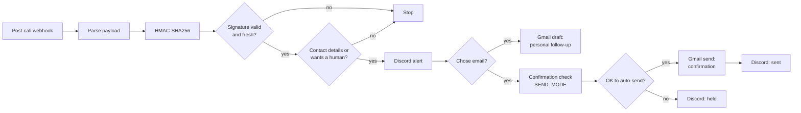

# Lead follow-up automation (n8n)

When a conversation with a website AI assistant ends (ElevenLabs Agents), its post-call webhook starts this n8n workflow.

## What it does
1. **Verifies the request.** The `elevenlabs-signature` header (`t=<unix>,v0=<hex>`) is checked with HMAC-SHA256 over `${t}.${rawBody}` and must be under 30 minutes old. Anything else stops.
2. **Keeps only real leads**: an email or phone number, a request for a human, or a data-deletion request.
3. **Alerts the team** in Discord with the summary and a link to the conversation.
4. **Emails the visitor** a short confirmation automatically (only if they chose email), and leaves a **personal follow-up as a Gmail draft** for the owner to edit and send.
5. **Safety switch:** `SEND_MODE = 'test'` only auto-sends to internal addresses; switch to `'live'` after a validated test. Invalid emails and deletion requests are never auto-emailed ("held" alert instead).

## Setup
1. Import `workflow.json` into n8n.
2. Create credentials: Gmail OAuth2 (your own Google Cloud OAuth client) and a Discord webhook. Select them on the Gmail and Discord nodes.
3. Replace the webhook path placeholder with a long random string.
4. Create the post-call webhook in your agent platform (HMAC auth) and paste the secret into the **HMAC** node.
5. Run a test conversation with an internal address, check the execution, then set `SEND_MODE` to `'live'`.

Notes: the webhook answers immediately (platforms disable failing webhooks); keep transcripts out of git; set n8n execution pruning to match your retention policy. Behind nginx, the editor needs websocket headers (`Upgrade`/`Connection`) on the n8n location.
